<!-- ================================================= -->
<!-- AKASH M | CYBERSECURITY PROFILE                   -->
<!-- ================================================= -->

<div align="center">
<picture>
  <source media="(prefers-color-scheme: dark)" srcset="./dark.svg">
  <source media="(prefers-color-scheme: light)" srcset="./light.svg">
  
</picture>
</div>

<p align="center">


</p>

---

<h2 align="center">01 // WHOAMI</h2>

```bash
┌──(akash㉿kali)-[~]
└─$ whoami

Name        : Akash M
Role        : Junior Penetration Tester
Focus       : Active Directory Security
Interest    : Red Team & Blue Team
Community   : Cybersecurity & CTF
Environment : Kali Linux / Windows Server
Status      : Always Learning

└─$ echo "Hello, Friend."
```

## 👨‍💻 ABOUT ME

I'm Akash M, a cybersecurity enthusiast and Junior Penetration Tester interested in understanding how systems, networks and applications can be attacked and defended.

My primary focus is **Active Directory Penetration Testing**, Windows security, network security and vulnerability assessment.

I enjoy building practical labs, exploring security tools, solving CTF challenges and documenting my technical experiments.

### My cybersecurity interests

- 🔴 Active Directory Penetration Testing
- 🔴 Network Penetration Testing
- 🔴 Windows Privilege Escalation
- 🔴 Red Team Operations
- 🔵 SIEM & Threat Detection
- 🔵 Intrusion Detection Systems
- 🌐 Web & API Security
- 🏴‍☠️ Capture The Flag Challenges
- 🔌 IoT & Embedded Security

---

## 02 // TECHNICAL SKILLS

### 🔴 Penetration Testing & Network Security

| Tool | Purpose |
|---|---|
| Nmap | Network scanning and service enumeration |
| Metasploit | Exploitation framework and payload testing |
| Burp Suite | Web application security testing |
| Wireshark | Network traffic analysis |
| Responder | LLMNR/NBT-NS and network poisoning lab experiments |
| NetExec | Network and Windows domain enumeration |
| CrackMapExec | Windows network security testing |
| Impacket | Network protocol and Active Directory utilities |
| enum4linux-ng | SMB and Windows enumeration |
| SMBClient | SMB share interaction |
| rpcclient | RPC enumeration |
| Evil-WinRM | Windows remote management lab access |
| PsExec | Remote administration and execution labs |

### 🏴‍☠️ Active Directory Security

| Tool | Purpose |
|---|---|
| BloodHound | Active Directory attack-path analysis |
| SharpHound | Active Directory data collection |
| PowerView | Domain enumeration |
| Rubeus | Kerberos security testing |
| Mimikatz | Windows credential security research |
| Kerbrute | Kerberos enumeration and authentication testing |
| Hashcat | Password hash auditing |
| John the Ripper | Password hash auditing |
| Impacket | Kerberos, SMB and Windows protocol testing |
| NetExec | Domain and network enumeration |

### 🔵 Blue Team & Defensive Security

| Tool | Purpose |
|---|---|
| Wazuh | SIEM, security monitoring and threat detection |
| Snort | Network intrusion detection |
| Wireshark | Packet analysis |
| Windows Event Logs | Windows security event investigation |
| Linux Logs | System and security log analysis |

### 🌐 Web & API Security

- Burp Suite
- Postman
- JWT Security Analysis
- OAuth Security Analysis
- HTTP Request/Response Analysis
- Web Vulnerability Assessment
- Directory Enumeration
- Security Headers Analysis
- CSRF Protection Analysis
- Cookie Security Analysis

### 🖥️ Operating Systems

<p align="center">

</p>

- Kali Linux
- Ubuntu Linux
- Windows 10 / Windows 11
- Windows Server 2008 R2
- Windows Server 2019

### 💻 Programming & Scripting

<p align="center">

</p>

- Python – Security automation and scripting
- PowerShell – Windows administration and AD enumeration
- Bash – Linux automation
- C – Programming fundamentals

### 🔧 Other Technical Tools

- VeraCrypt – File and volume encryption
- PE Explorer – Windows executable analysis
- Git & GitHub – Version control
- Docker – Container-based environments
- VirtualBox / VMware – Virtual lab environments

---

## 03 // ACTIVE DIRECTORY KNOWLEDGE

Active Directory is my primary cybersecurity learning and research focus.

### Protocols & Services

| Protocol | Port |
|---|---:|
| DNS | 53 |
| Kerberos | 88 |
| LDAP | 389 |
| LDAPS | 636 |
| SMB | 445 |
| Kerberos Password Change | 464 |
| Global Catalog | 3268 |
| Global Catalog SSL | 3269 |
| RDP | 3389 |

### Concepts & Techniques Studied

- Active Directory Enumeration
- Kerberos Authentication
- LDAP Enumeration
- SMB Enumeration
- NTLM Authentication
- LLMNR Poisoning
- NBT-NS Poisoning
- WPAD
- IPv6/DNS Spoofing Concepts
- Kerberoasting
- AS-REP Roasting
- NTLM Relay
- Pass-the-Hash
- Group Policy Preferences (GPP)
- Service Principal Names (SPNs)
- Windows Privilege Escalation
- Token Impersonation
- WinRM Enumeration

### Lab Environments

- MARVEL.local Active Directory Lab
- Windows Server 2019
- Windows Server 2008 R2
- Windows 10 / Windows 11
- Kali Linux

---

## 04 // HANDS-ON EXPERIENCE

### Cyber Security Intern — ShadowFox

**December 2025 – Present**

- Network port scanning and service enumeration.
- Web directory enumeration.
- HTTP traffic analysis using Wireshark.
- Password hash identification and cracking exercises.
- File and volume encryption using VeraCrypt.
- Windows executable analysis using PE Explorer.
- Metasploit payload testing in lab environments.
- Wi-Fi handshake capture and security analysis.

### Other Cybersecurity Internships

- **Future Interns**
- **Redynox**

### Practical Security Labs

- Active Directory enumeration and security testing.
- Windows and Linux privilege escalation exercises.
- Network traffic investigation.
- Web application vulnerability testing.
- Metasploitable 2 security lab.
- CTF challenges and vulnerable machine assessments.
- Wazuh security monitoring experiments.

---

## 05 // PROJECTS

### 🔴 1. Active Directory Intrusion Detection

**Technologies:** Wazuh | Snort | Windows Server | Kali Linux

A security monitoring project focused on identifying suspicious activities in an Active Directory environment.

- Monitor Active Directory security events.
- Collect and analyze security logs.
- Detect suspicious network activity.
- Monitor authentication-related events.
- Explore intrusion detection using Snort.
- Visualize security alerts using Wazuh Dashboard.

### 🔴 2. ESP32 IoT Honeypot

**Technologies:** ESP32 | Python | HTTP | FTP | SSH | MQTT | Blynk

A defensive IoT security project designed to simulate vulnerable IoT services and identify suspicious interactions.

- Fake IoT web interface.
- Simulated HTTP, FTP, SSH and MQTT services.
- Credential and SQL injection pattern detection.
- Admin OTP verification.
- Blynk alert notifications.
- SPIFFS-based IP blocking.

### 🔴 3. ESP32 Fire Detection System with yolo algorithm 

**Technologies:** ESP32-CAM | YOLOv8 | Blynk

An IoT-based fire detection concept combining camera-based detection and sensor monitoring.

- ESP32-CAM integration.
- YOLOv8-based visual detection.
- Sensor-based monitoring.
- Blynk notification alerts.

### 🔴 6. OLED Smart Display

**Technologies:** ESP32 | OLED SSD1306 | NTP

- 128×64 OLED display.
- NTP-based time synchronization.
- Date and time display.
- Animated eye interface.

---

## 06 // CTF & SECURITY RESEARCH

I enjoy learning cybersecurity through practical challenges and vulnerable environments.

### Areas of Exploration

- Active Directory CTF
- Windows Privilege Escalation
- Linux Privilege Escalation
- Web Exploitation
- Network Enumeration
- Authentication Weaknesses
- SMB Security
- Password Hash Analysis
- Linux Privilege and Permission Issues

### Lab Platforms & Environments

- Kali Linux
- Metasploitable 2
- Windows Server Labs
- Custom Active Directory Labs
- Vulnerable Web Applications

---

## 07 // CURRENT LEARNING ROADMAP

```text
[████████████████░░░░] Active Directory Security
[███████████████░░░░░] Windows Pentesting
[██████████████░░░░░░] Network Penetration Testing
[████████████░░░░░░░░] SIEM & Threat Detection
[████████████░░░░░░░░] Python Security Automation
[███████████░░░░░░░░░] Red Team Operations
```

---

## 08 // GITHUB STATISTICS

<p align="center">


</p>

<p align="center">

</p>

---

## 09 // CONNECT WITH ME

<p align="center">
<a href="https://github.com/Akash-iot">

</a>

<a href="https://www.linkedin.com/in/akash2201">

</a>

<a href="https://medium.com/@akashmurugansasikala2208">

</a>
</p>

---

<p align="center">

</p>

<p align="center">

</p>

<h3 align="center">👁️ THINK LIKE AN ATTACKER. DEFEND LIKE A PROFESSIONAL.</h3>

<p align="center"><code>AKASH M // FSOCIETY // END OF TRANSMISSION</code></p>
